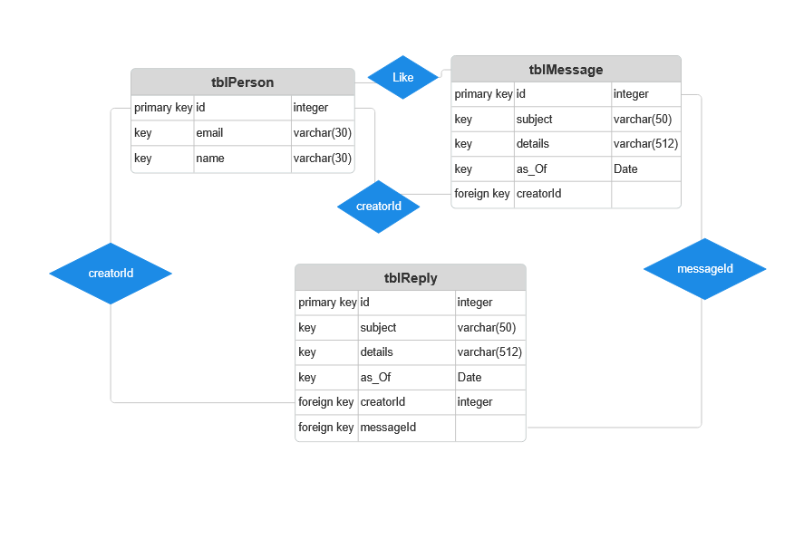
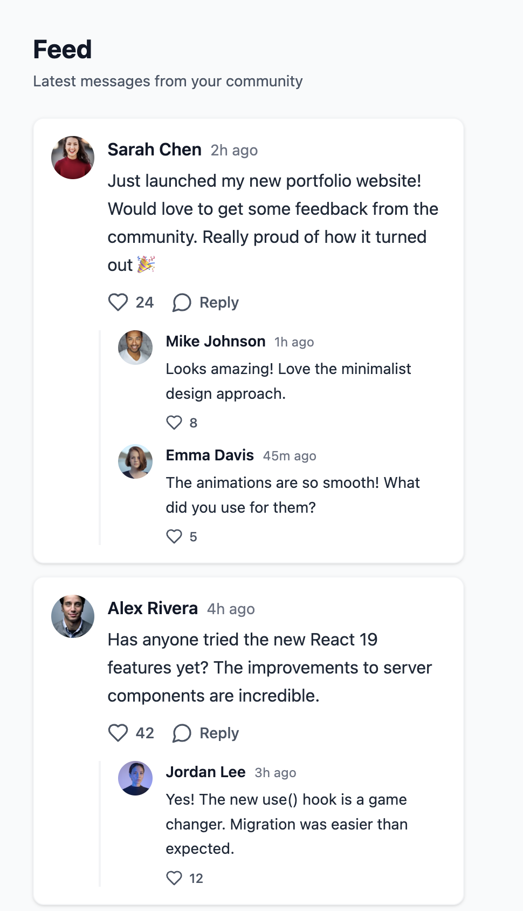
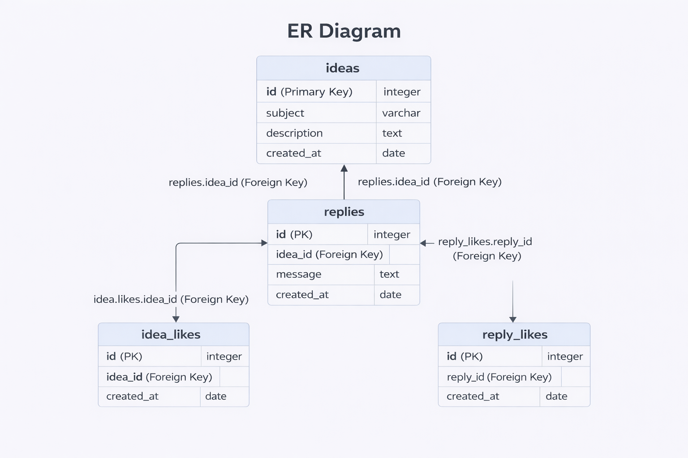

# Phase 2: Likes & Replies 

## Team
- PM: Julia Salinero (jus628)
- Backend: Leo Xu (lex227)
- Frontend: Jack Lamb (jal228)
- Admin: Sakshi Mishra (sam227)

## What We Added
- Sprint 5: Design artifacts including ERD, UI Mockup & API design, user stories, verified phase 1 still working.
- Sprint 6: Implemented likes and replies functionality across all components. Backend routes live on Dokku. Frontend updated with like buttons and reply UI. Admin CLI updated with tblLike and tblReply support and unit tests.

## Deployment
**Live App:** https://team-04.dokku.cse.lehigh.edu

## Overview
Phase 2 extends The Buzz to support:
- **Liking** a message (and removing the like)
- **Replying** to a message
- **Viewing** like counts and replies on each message

## Status
[DONE]

## Git Logs
Team member contributions:
Sprint 5:
- [Backend (Leo)](./gitlogs/gitlog-team04-sprint05-backend-lex227.txt)
- [Admin (Sakshi)](./gitlogs/gitlog-team04-sprint05-admin-sam227.txt)
- [Frontend (Jack)](./gitlogs/gitlog-team04-sprint05-frontend-jal228.txt)
- [Main & Pre-Main (Julia)](./gitlogs/gitlog-team04-sprint05-main-jus628.txt)

Sprint 6:
- [Backend (Leo)](./gitlogs/gitlog-team04-sprint06-backend-lex227.txt)
- [Admin (Sakshi)](./gitlogs/gitlog-team04-sprint06-admin-sam227.txt)
- [Frontend (Jack)](./gitlogs/gitlog-team04-sprint06-frontend-jal228.txt)
- [Main & Pre-Main (Julia)](./gitlogs/gitlog-team04-sprint06-main-jus628.txt)

## Design Artifacts

### Database Design

**Schema Changes:**
- tblLike: tracks which user liked which message (creatorId FK, messageId FK)
- tblReply: id, subject, details, as_Of, creatorId (FK), messageId (FK)

### UI Mockup

### API Design
- Likes on Ideas
- `POST /ideas/{id}/like` - Like an idea → `{ "likeCount": 6, "userLiked": true }`
- `DELETE /ideas/{id}/like` - Unlike an idea → `{ "likeCount": 5, "userLiked": false }`
- `GET /ideas/{id}` - Get idea with like info → includes `likeCount` and `userLiked` fields

- Replies to Ideas
- `POST /ideas/{id}/replies` - Add reply → Request: `{ "content": "text", "parentReplyId": null }` 
- `GET /ideas/{id}/replies` - Get all replies → Returns array with `id`, `content`, `userId`, `userName`, `likeCount`, `userLiked`, `parentReplyId`

- Likes on Replies
- `POST /replies/{id}/like` - Like a reply → `{ "likeCount": 4, "userLiked": true }`
- `DELETE /replies/{id}/like` - Unlike a reply → `{ "likeCount": 3, "userLiked": false }`

### ER Diagram

## User Stories
- **Likes:**
    - As a user, I want to like a message so that I can show if I agree with or enjoy content.
    - As a user, I want to unlike a message so that I can change my mind about content I previously liked.
    - As a user, I want to see the total like count on each message so that I can gauge how popular it is.
- **Replies:**
    - As a user, I want to reply to a message so that I can respond directly to someone's idea or post.
    - As a user, I want to view all replies on a message so that I can follow the conversation around it.
- **Admin:**
    - As an admin, I want to invalidate (hide) a reply so that I can moderate inappropriate responses.
    - As an admin, I want to view all replies in the system so that I can monitor platform activity.